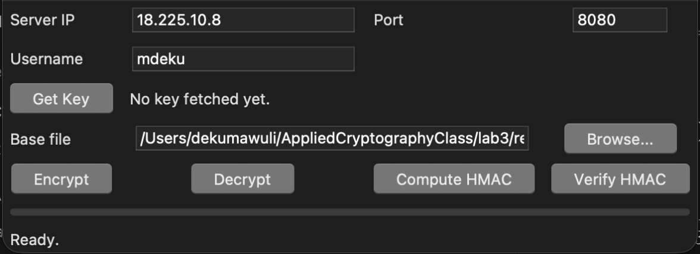
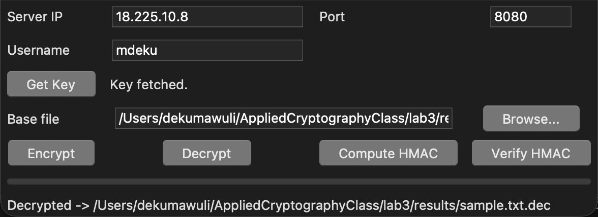
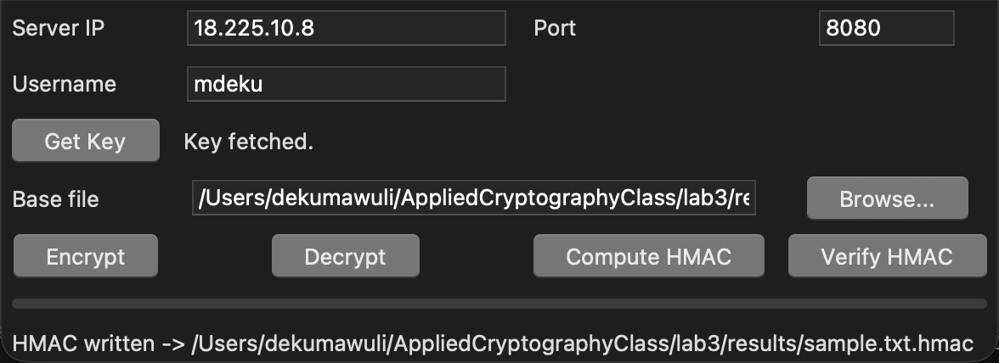
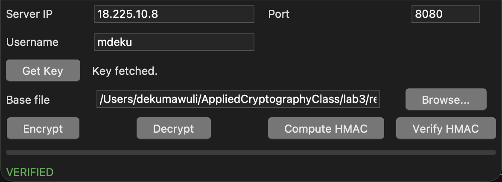
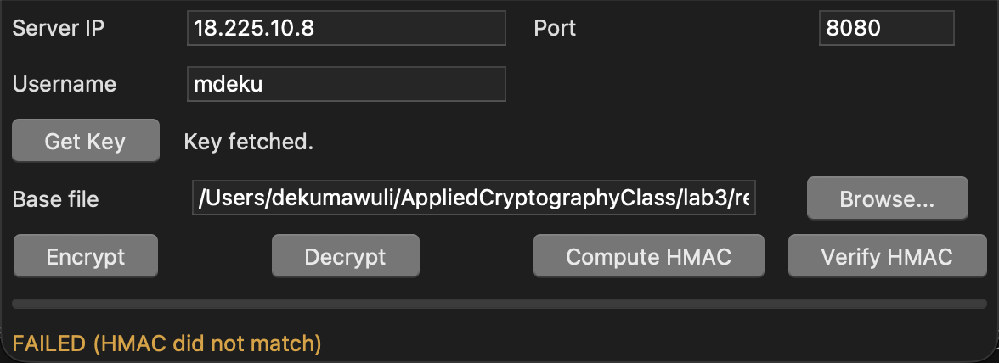

# Applied Cryptography Lab 3 — AES Encryption and Hashing

A tkinter client implementing `crypto_message_spec_v2.md`: AES-256-GCM encrypt/decrypt and the
course's custom HMAC compute/verify, against the instructor's server.

Source repository: <https://github.com/DekuMawuli/lab3-crypto>

## Workflow (lineage visible in git history)

1. `Requirements_v1.md` — student-authored, committed before any AI involvement.
2. `requirements_v2.md`, `design_v1.md` — AI-assisted refinement.
3. `crypto_client/` — source and tests.
4. `interrogation.md` — design/implementation Q&A.

## Where to find the results

- `crypto_client/tests/` — automated tests, including the spec's section 9 vectors for framing,
  AES-GCM, and the custom HMAC, plus an offline round trip against `fake_server.py`.
- Run them: `.venv/bin/python -m pytest crypto_client/` (22 passing as of the last commit).
- `results/ROUND_TRIP.md` — evidence of both round trips against the real server
  (`18.225.10.8:8080`, user `mdeku`): AES-GCM encrypt/decrypt matches the original file
  byte-for-byte, and HMAC verify returns `VERIFIED` on the real file, `FAILED` after a
  one-byte tamper. Key material is never committed (`.key`/`.hmackey` are gitignored).

## Screenshots: the app working against the real server

Captured by driving the real UI (`results/screenshots/_capture_demo.py`) through both
workflows end-to-end, since the AES/HMAC keys themselves can't be shared for someone
else to re-run this independently.

**AES-256-GCM — get a key, encrypt locally, decrypt via the server**

| | |
|---|---|
|  |  |
| Initial state, idle | After `Get Key` |
|  |  |
| After `Encrypt` — `sample.txt.enc` written | After `Decrypt` — server's reply written to `sample.txt.dec`, byte-for-byte identical to the original |

**Custom HMAC — get a key, compute locally, verify via the server**

| | |
|---|---|
|  |  |
| After `Compute HMAC` | After `Verify HMAC` on the untouched file — green **VERIFIED** |
|  | |
| Same key and HMAC, file with one byte flipped — orange **FAILED**, not a red error, confirming the two outcomes are shown distinctly (spec section 4.3) |
